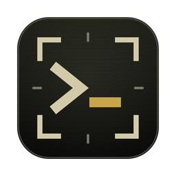
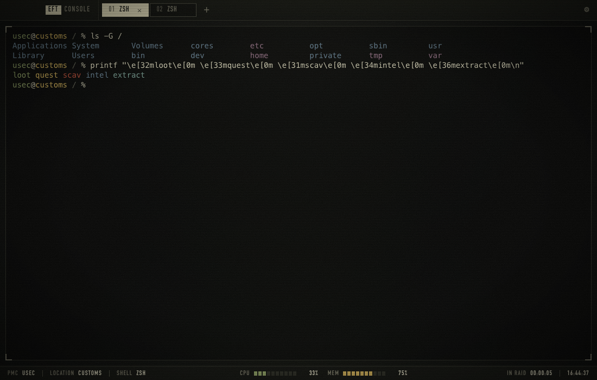

<p align="center"></p>

# EFTconsole

A terminal for macOS and Windows dressed up in an *Escape from Tarkov*-inspired
interface: khaki-on-black palette, tactical tab bar, film grain and scanlines,
a "deploying" boot screen, CPU/MEM health bars and a raid timer. Built with
[Tauri](https://tauri.app), so the installer is about 3 MB.



> Fan-made project. Not affiliated with, endorsed by, or connected to Battlestate Games.
> *Escape from Tarkov* is a trademark of its respective owner. No game assets are used.

## Features

- Real shell via [portable-pty](https://crates.io/crates/portable-pty) + [xterm.js](https://xtermjs.org):
  zsh/bash on macOS, PowerShell 7 (`pwsh`) or Windows PowerShell on Windows
- Tabs, clickable links, truecolor, 10k-line scrollback
- Status bar: PMC callsign, location (hostname), shell, CPU/MEM meters, time in raid, clock
- Raid-end screens when a shell ends: **SURVIVED** (exit code 0), **KILLED IN ACTION**
  (non-zero exit code), and **KILLED · HEAD, EYES** when the shell process is killed from
  outside (a signal on macOS; `taskkill /F`, Task Manager or `Stop-Process` on Windows, which
  also covers an explicit `exit 1`). `Enter` redeploys, `Esc` closes the tab.
  To see it: `kill -9 $$` (macOS) or `Stop-Process -Id $PID` (PowerShell)
- Config file at `~/.eftconsole.json`

## Install

Grab the `.dmg` (macOS) or `.exe` installer (Windows) from
[Releases](https://github.com/dzotyara/EFTconsole/releases).

Builds are not code-signed. On macOS, if Gatekeeper says the app is damaged:

```bash
xattr -cr /Applications/EFTconsole.app
```

On Windows, SmartScreen may warn on first launch: *More info → Run anyway*. The app uses
the system WebView2 (built into Windows 11); on older Windows 10 the installer downloads it.

## Run from source

Requires Node.js 18+, [Rust](https://rustup.rs) and the
[Tauri prerequisites](https://tauri.app/start/prerequisites/) for your OS
(Xcode Command Line Tools on macOS, MSVC Build Tools on Windows).

```bash
npm install
npm run dev
```

Build the installer (`src-tauri/target/release/bundle/`):

```bash
npm run build
```

End-to-end QA: the app drives its own UI with real shells (`src/renderer/qa.js`), then checks
that no shell processes are left behind:

```bash
npx tauri build --no-bundle
npm run qa
```

Pushing a `v*` tag makes GitHub Actions build and QA both platforms and attach the installers
to a release.

## Shortcuts

| Action           | macOS            | Windows                     |
| ---------------- | ---------------- | --------------------------- |
| New tab          | `Cmd+T`          | `Ctrl+Shift+T`              |
| Close tab        | `Cmd+W`          | `Ctrl+Shift+W`              |
| Next / prev tab  | `Ctrl+Tab` / `Ctrl+Shift+Tab` | same           |
| Go to tab 1–9    | `Cmd+1…9`        | `Ctrl+1…9`                  |
| Copy             | `Cmd+C`          | `Ctrl+C` (with selection), `Ctrl+Shift+C` |
| Paste            | `Cmd+V`          | `Ctrl+V`, `Ctrl+Shift+V`    |
| Clear            | `Cmd+K`          | `Ctrl+Shift+K`              |
| Font size        | `Cmd+=` / `Cmd+-` / `Cmd+0` | `Ctrl+=` / `Ctrl+-` / `Ctrl+0` |

Right click copies the selection, or pastes when nothing is selected.

## Config

Click the gear in the title bar (or *Shell → Open Config* on macOS) to create and open
`~/.eftconsole.json` (override the location with the `EFTCONSOLE_CONFIG` environment variable).
Every key is optional; restart the app to apply changes.

```json
{
  "shell": null,
  "shellArgs": null,
  "fontSize": 14,
  "fontFamily": null,
  "bootAnimation": true,
  "scanlines": true,
  "cursorBlink": true,
  "callsign": null
}
```

- `shell` / `shellArgs` — e.g. `"C:\\Program Files\\Git\\bin\\bash.exe"` and `["--login"]`
- `fontFamily` — CSS font stack, defaults to JetBrains Mono → Cascadia Mono → SF Mono → Menlo → Consolas
- `callsign` — name shown after **PMC** in the status bar (defaults to your OS user name)

For the most authentic look, install the free **Bender** font: the UI picks it up automatically
and falls back to Bahnschrift (Windows) or DIN Condensed (macOS).

---

## По-русски

Терминал для macOS и Windows в стилистике интерфейса *Escape from Tarkov*.
Фанатский проект, не связан с Battlestate Games, игровые ассеты не используются.

- Установщики — во вкладке [Releases](https://github.com/dzotyara/EFTconsole/releases)
- Из исходников: `npm install`, затем `npm start` (нужен Node.js 22.12+)
- Настройки — шестерёнка в заголовке окна, файл `~/.eftconsole.json`
- Шелл завершился с кодом 0 — **SURVIVED**, с другим кодом — **KILLED IN ACTION**, процесс убили — **KILLED · HEAD, EYES**; `Enter` — заново, `Esc` — закрыть вкладку

## License

[MIT](LICENSE)
