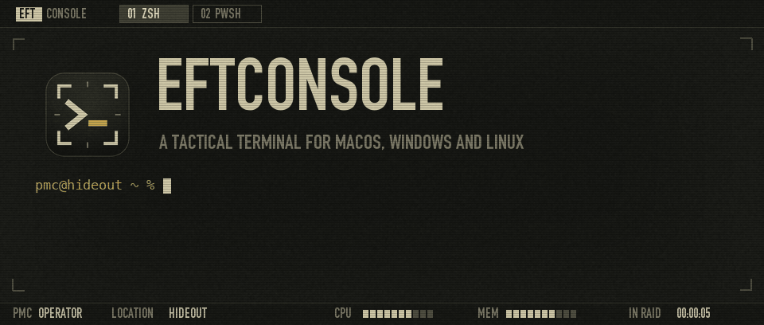
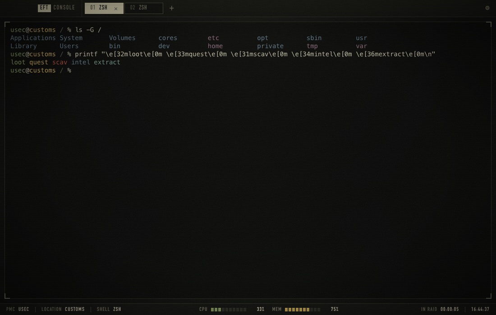
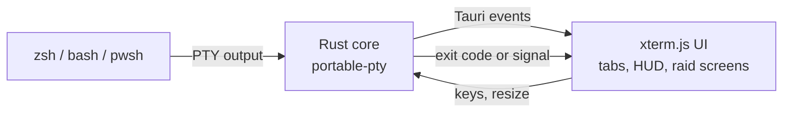

<p align="center">
  
</p>

<h1 align="center">Every shell session is a raid</h1>

<p align="center">
  <b>EFTconsole is a real terminal dressed in an <i>Escape from Tarkov</i>-inspired interface.</b><br>
  zsh, bash or PowerShell inside, a tactical HUD outside. macOS, Windows and Linux, about 3 MB.
</p>

<p align="center">
  <a href="https://github.com/dzotyara/EFTconsole/releases/latest"></a>
  <a href="#see-it-in-action"></a>
  <a href="https://github.com/dzotyara/EFTconsole"></a>
  <a href="https://boosty.to/dzotyara"></a>
</p>

<p align="center">
  <a href="https://github.com/dzotyara/EFTconsole/actions/workflows/build.yml"></a>
  
  
  
  
  
  <a href="LICENSE"></a>
</p>

<p align="center">
  ⭐ <b>If EFTconsole made your terminal more fun, <a href="https://github.com/dzotyara/EFTconsole">star the repo</a>.</b> It helps other people find it.
</p>

<p align="center">
  <b>English</b> · <a href="README.ru.md">Русский</a>
</p>

---

> Fan-made project. Not affiliated with, endorsed by, or connected to Battlestate Games.
> *Escape from Tarkov* is a trademark of its respective owner. No game assets are used.

<table>
<tr>
<td width="33%" valign="top">

### 🎯 A real shell
Not a toy. Your own zsh or bash on macOS and Linux, PowerShell 7 on Windows, through a real PTY. Truecolor, links, tabs, 10k lines of scrollback.

</td>
<td width="33%" valign="top">

### 🪖 Every exit is a raid end
Exit code 0 is **SURVIVED**. Anything else is **KILLED IN ACTION**. A shell killed from outside gets **KILLED · HEAD, EYES**. `Enter` redeploys.

</td>
<td width="33%" valign="top">

### 📟 A tactical HUD
PMC callsign, location (your hostname), shell, live CPU and MEM bars, time in raid and a clock. Film grain, scanlines and a "deploying" boot screen.

</td>
</tr>
</table>

<p align="center">
  <b>~3 MB</b> installer · <b>3</b> platforms · <b>0</b> game assets
</p>

## See it in action

<p align="center"></p>

Want to see the raid-end screen? Run `kill -9 $$` (macOS, Linux) or `Stop-Process -Id $PID` (PowerShell).

## Download

Grab the installer for your system from [**Releases**](https://github.com/dzotyara/EFTconsole/releases/latest).

| System | File | Install |
|---|---|---|
| macOS, Apple Silicon | `EFTconsole_<version>_aarch64.dmg` | open and drag to Applications |
| macOS, Intel | `EFTconsole_<version>_x64.dmg` | open and drag to Applications |
| Windows 10/11 | `EFTconsole_<version>_x64-setup.exe` | run the installer |
| Debian, Ubuntu, Mint | `EFTconsole_<version>_amd64.deb` / `_arm64.deb` | `sudo apt install ./EFTconsole_*.deb` |
| Fedora, openSUSE | `EFTconsole-<version>-1.x86_64.rpm` / `.aarch64.rpm` | `sudo dnf install ./EFTconsole-*.rpm` |
| Any Linux | `EFTconsole_<version>_amd64.AppImage` / `_aarch64.AppImage` | `chmod +x EFTconsole_*.AppImage` and run it |

Builds are not code-signed.

- **macOS:** if Gatekeeper says the app is damaged, run `xattr -cr /Applications/EFTconsole.app`.
- **Windows:** SmartScreen may warn on first launch: *More info → Run anyway*. The app uses the system WebView2 (built into Windows 11); on older Windows 10 the installer downloads it.
- **Linux:** the app needs WebKitGTK 4.1 (`libwebkit2gtk-4.1-0`). The `.deb` and `.rpm` pull it in; for the AppImage, install it with your package manager if it is missing.

## Features

- Real shell via [portable-pty](https://crates.io/crates/portable-pty) + [xterm.js](https://xtermjs.org): your login `$SHELL` on macOS and Linux (zsh or bash), PowerShell 7 (`pwsh`) or Windows PowerShell on Windows
- Tabs, clickable links, truecolor, 10k-line scrollback
- Status bar: PMC callsign, location (hostname), shell, CPU/MEM meters, time in raid, clock
- Raid-end screens when a shell ends:
  - **SURVIVED**: exit code 0
  - **KILLED IN ACTION**: non-zero exit code
  - **KILLED · HEAD, EYES**: the shell process was killed from outside (a signal on macOS and Linux; `taskkill /F`, Task Manager or `Stop-Process` on Windows, which also covers an explicit `exit 1`)
  - `Enter` redeploys, `Esc` closes the tab
- Config file at `~/.eftconsole.json`

## Shortcuts

| Action           | macOS            | Windows and Linux           |
| ---------------- | ---------------- | --------------------------- |
| New tab          | `Cmd+T`          | `Ctrl+Shift+T`              |
| Close tab        | `Cmd+W`          | `Ctrl+Shift+W`              |
| Next / prev tab  | `Ctrl+Tab` / `Ctrl+Shift+Tab` | same           |
| Go to tab 1–9    | `Cmd+1…9`        | `Ctrl+1…9`                  |
| Copy             | `Cmd+C`          | `Ctrl+C` (with selection), `Ctrl+Shift+C` |
| Paste            | `Cmd+V`          | `Ctrl+V`, `Ctrl+Shift+V`    |
| Clear            | `Cmd+K`          | `Ctrl+Shift+K`              |
| Font size        | `Cmd+=` / `Cmd+-` / `Cmd+0` | `Ctrl+=` / `Ctrl+-` / `Ctrl+0` |

Right click copies the selection, or pastes when nothing is selected.

## Config

Click the gear in the title bar (or *Shell → Open Config* on macOS) to create and open
`~/.eftconsole.json`. Override the location with the `EFTCONSOLE_CONFIG` environment variable.
Every key is optional; restart the app to apply changes.

```json
{
  "shell": null,
  "shellArgs": null,
  "fontSize": 14,
  "fontFamily": null,
  "bootAnimation": true,
  "scanlines": true,
  "cursorBlink": true,
  "callsign": null
}
```

| Key | Default | What it does |
|---|---|---|
| `shell` / `shellArgs` | your `$SHELL -l`; `pwsh` on Windows | any shell, e.g. `"C:\\Program Files\\Git\\bin\\bash.exe"` and `["--login"]` |
| `fontSize` | `14` | terminal font size |
| `fontFamily` | JetBrains Mono → Cascadia Mono → SF Mono → Menlo → Consolas | CSS font stack |
| `bootAnimation` | `true` | the "deploying" screen on start |
| `scanlines` | `true` | the scanline overlay |
| `cursorBlink` | `true` | blinking cursor |
| `callsign` | your OS user name | name shown after **PMC** in the status bar |

For the most authentic look, install the free **Bender** font: the UI picks it up automatically
and falls back to Bahnschrift (Windows) or DIN Condensed (macOS).

## How it works



The Rust side spawns each shell in a pseudo-terminal, streams its output to the window and reports
how it ended. The UI is plain HTML, CSS and JavaScript with xterm.js. Tauri uses the system webview,
so there is no bundled browser and the installer stays around 3 MB.

## Build from source

Requires Node.js 18+, [Rust](https://rustup.rs) and the
[Tauri prerequisites](https://tauri.app/start/prerequisites/) for your OS
(Xcode Command Line Tools on macOS, MSVC Build Tools on Windows, WebKitGTK 4.1 on Linux).

```bash
npm install
npm run dev
```

Build the installer (`src-tauri/target/release/bundle/`):

```bash
npm run build
```

End-to-end QA: the app drives its own UI with real shells (`src/renderer/qa.js`), then checks
that no shell processes are left behind:

```bash
npx tauri build --no-bundle
npm run qa
```

Pushing a `v*` tag makes GitHub Actions build all three platforms, run QA on macOS, Windows and
Linux, and attach the installers to a release.

## FAQ

**Is it a real terminal or a skin over a fake one?**
A real one. It runs your own shell in a PTY, so `vim`, `htop`, `ssh` and your prompt theme work as usual.

**Does it touch my shell config?**
No. It starts your login shell as is. The app only reads `~/.eftconsole.json`.

**Why is the app not signed?**
Signing certificates cost money every year, and this is a free fan project. The builds come straight from GitHub Actions; you can check the workflow in `.github/workflows/build.yml`.

## Support EFTconsole

- ⭐ **Star the repo.** It's the fastest way to help other people find it.
- ☕ **[Support me on Boosty](https://boosty.to/dzotyara).** A one-time tip or a monthly subscription gives me more time for EFTconsole and new tools.
- 🐞 **Open an issue** with a bug or an idea.

## License

[MIT](LICENSE): take it, change it and use it, keeping the author credit.

---

<p align="center">
  Like it? <a href="https://github.com/dzotyara/EFTconsole">⭐ Star the repo</a> or <a href="https://boosty.to/dzotyara">☕ support me on Boosty</a>.
</p>
