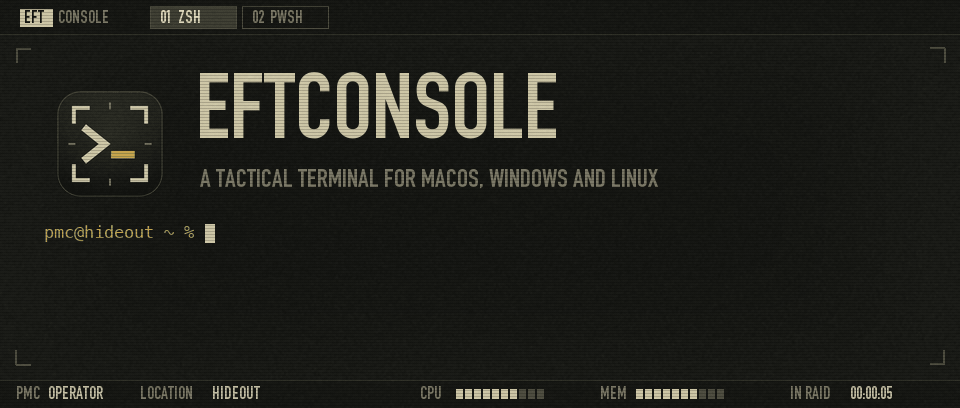
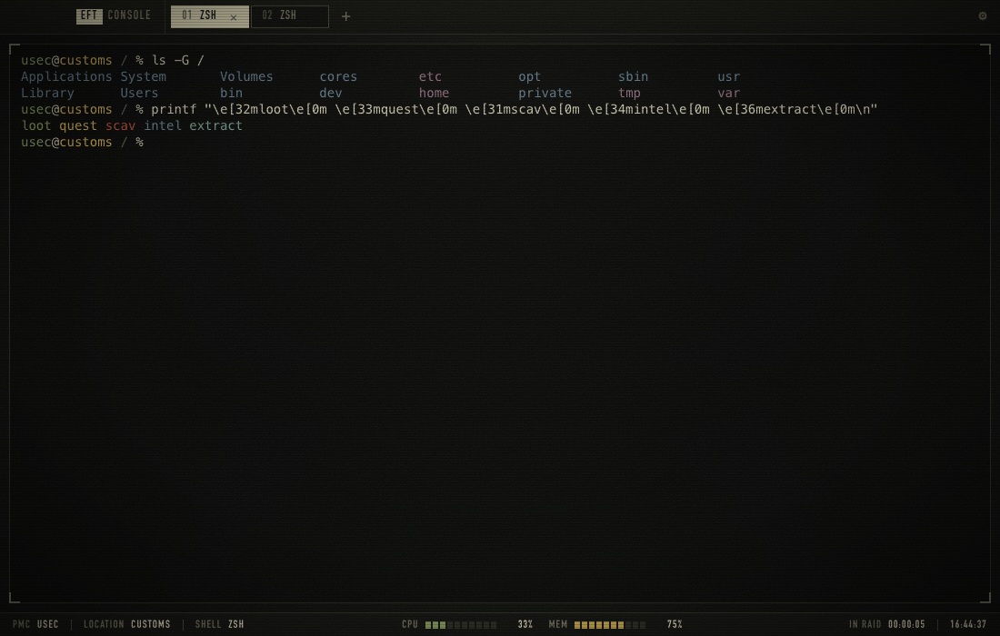
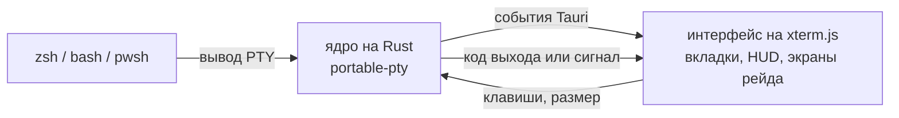

<p align="center">
  
</p>

<h1 align="center">Каждая сессия в шелле — это рейд</h1>

<p align="center">
  <b>EFTconsole — настоящий терминал в интерфейсе по мотивам <i>Escape from Tarkov</i>.</b><br>
  Внутри zsh, bash или PowerShell, снаружи тактический HUD. macOS, Windows и Linux, около 3 МБ.
</p>

<p align="center">
  <a href="https://github.com/dzotyara/EFTconsole/releases/latest"></a>
  <a href="#demo"></a>
  <a href="https://github.com/dzotyara/EFTconsole"></a>
  <a href="https://boosty.to/dzotyara"></a>
</p>

<p align="center">
  <a href="https://github.com/dzotyara/EFTconsole/actions/workflows/build.yml"></a>
  
  
  
  
  
  <a href="LICENSE"></a>
</p>

<p align="center">
  ⭐ <b>Если с EFTconsole в терминале стало веселее, <a href="https://github.com/dzotyara/EFTconsole">поставьте звезду</a>.</b> Так проект проще найти другим.
</p>

<p align="center">
  <a href="README.md">English</a> · <b>Русский</b>
</p>

---

> Фанатский проект. Не связан с Battlestate Games и не одобрен ею.
> *Escape from Tarkov* — товарный знак его владельца. Игровые ассеты не используются.

<table>
<tr>
<td width="33%" valign="top">

### 🎯 Настоящий шелл
Не игрушка. Ваш zsh или bash на macOS и Linux, PowerShell 7 на Windows, через настоящий PTY. Truecolor, ссылки, вкладки, 10 тысяч строк прокрутки.

</td>
<td width="33%" valign="top">

### 🪖 Каждый выход — конец рейда
Код выхода 0 — **SURVIVED**. Любой другой — **KILLED IN ACTION**. Шелл убили снаружи — **KILLED · HEAD, EYES**. `Enter` — заново в рейд.

</td>
<td width="33%" valign="top">

### 📟 Тактический HUD
Позывной PMC, локация (имя компьютера), шелл, живые полоски CPU и MEM, время в рейде и часы. Зерно, скан-линии и экран «deploying» при запуске.

</td>
</tr>
</table>

<p align="center">
  <b>~3 МБ</b> установщик · <b>3</b> платформы · <b>0</b> игровых ассетов
</p>

<a id="demo"></a>
## Как это выглядит

<p align="center"></p>

Хотите увидеть экран конца рейда? Выполните `kill -9 $$` (macOS, Linux) или `Stop-Process -Id $PID` (PowerShell).

## Скачать

Установщик для вашей системы — в [**Releases**](https://github.com/dzotyara/EFTconsole/releases/latest).

| Система | Файл | Установка |
|---|---|---|
| macOS, Apple Silicon | `EFTconsole_<версия>_aarch64.dmg` | открыть и перетащить в «Программы» |
| macOS, Intel | `EFTconsole_<версия>_x64.dmg` | открыть и перетащить в «Программы» |
| Windows 10/11 | `EFTconsole_<версия>_x64-setup.exe` | запустить установщик |
| Debian, Ubuntu, Mint | `EFTconsole_<версия>_amd64.deb` / `_arm64.deb` | `sudo apt install ./EFTconsole_*.deb` |
| Fedora, openSUSE | `EFTconsole-<версия>-1.x86_64.rpm` / `.aarch64.rpm` | `sudo dnf install ./EFTconsole-*.rpm` |
| Любой Linux | `EFTconsole_<версия>_amd64.AppImage` / `_aarch64.AppImage` | `chmod +x EFTconsole_*.AppImage` и запустить |

Сборки не подписаны.

- **macOS:** если Gatekeeper пишет, что приложение повреждено, выполните `xattr -cr /Applications/EFTconsole.app`.
- **Windows:** при первом запуске SmartScreen может предупредить: *Подробнее → Выполнить в любом случае*. Приложение использует системный WebView2 (он есть в Windows 11); на старой Windows 10 установщик скачает его сам.
- **Linux:** нужен WebKitGTK 4.1 (`libwebkit2gtk-4.1-0`). `.deb` и `.rpm` ставят его сами; для AppImage поставьте его менеджером пакетов, если его нет.

## Что умеет

- Настоящий шелл через [portable-pty](https://crates.io/crates/portable-pty) и [xterm.js](https://xtermjs.org): ваш login `$SHELL` на macOS и Linux (zsh или bash), PowerShell 7 (`pwsh`) или Windows PowerShell на Windows
- Вкладки, кликабельные ссылки, truecolor, 10 тысяч строк прокрутки
- Статус-бар: позывной PMC, локация (имя компьютера), шелл, полоски CPU/MEM, время в рейде, часы
- Экраны конца рейда, когда шелл завершился:
  - **SURVIVED** — код выхода 0
  - **KILLED IN ACTION** — ненулевой код выхода
  - **KILLED · HEAD, EYES** — процесс шелла убили снаружи (сигналом на macOS и Linux; `taskkill /F`, диспетчером задач или `Stop-Process` на Windows, туда же попадает явный `exit 1`)
  - `Enter` — заново, `Esc` — закрыть вкладку
- Настройки в файле `~/.eftconsole.json`

## Горячие клавиши

| Действие                | macOS            | Windows и Linux             |
| ----------------------- | ---------------- | --------------------------- |
| Новая вкладка           | `Cmd+T`          | `Ctrl+Shift+T`              |
| Закрыть вкладку         | `Cmd+W`          | `Ctrl+Shift+W`              |
| Следующая / предыдущая  | `Ctrl+Tab` / `Ctrl+Shift+Tab` | так же         |
| Вкладка 1–9             | `Cmd+1…9`        | `Ctrl+1…9`                  |
| Копировать              | `Cmd+C`          | `Ctrl+C` (если есть выделение), `Ctrl+Shift+C` |
| Вставить                | `Cmd+V`          | `Ctrl+V`, `Ctrl+Shift+V`    |
| Очистить                | `Cmd+K`          | `Ctrl+Shift+K`              |
| Размер шрифта           | `Cmd+=` / `Cmd+-` / `Cmd+0` | `Ctrl+=` / `Ctrl+-` / `Ctrl+0` |

Правый клик копирует выделение, а если ничего не выделено — вставляет.

## Настройки

Шестерёнка в заголовке окна (или *Shell → Open Config* на macOS) создаёт и открывает
`~/.eftconsole.json`. Путь можно поменять переменной окружения `EFTCONSOLE_CONFIG`.
Все ключи необязательные; чтобы изменения применились, перезапустите приложение.

```json
{
  "shell": null,
  "shellArgs": null,
  "fontSize": 14,
  "fontFamily": null,
  "bootAnimation": true,
  "scanlines": true,
  "cursorBlink": true,
  "callsign": null
}
```

| Ключ | По умолчанию | Что делает |
|---|---|---|
| `shell` / `shellArgs` | ваш `$SHELL -l`; `pwsh` на Windows | любой шелл, например `"C:\\Program Files\\Git\\bin\\bash.exe"` и `["--login"]` |
| `fontSize` | `14` | размер шрифта в терминале |
| `fontFamily` | JetBrains Mono → Cascadia Mono → SF Mono → Menlo → Consolas | CSS-стек шрифтов |
| `bootAnimation` | `true` | экран «deploying» при запуске |
| `scanlines` | `true` | скан-линии поверх окна |
| `cursorBlink` | `true` | мигающий курсор |
| `callsign` | имя пользователя в системе | позывной после **PMC** в статус-баре |

Для самого похожего вида поставьте бесплатный шрифт **Bender**: интерфейс подхватит его сам,
а без него возьмёт Bahnschrift (Windows) или DIN Condensed (macOS).

## Как устроено



Rust запускает каждый шелл в псевдотерминале, передаёт его вывод в окно и сообщает, чем всё
кончилось. Интерфейс — обычные HTML, CSS и JavaScript с xterm.js. Tauri использует системный
webview, браузер внутрь не вшит, поэтому установщик весит около 3 МБ.

## Сборка из исходников

Нужны Node.js 18+, [Rust](https://rustup.rs) и
[зависимости Tauri](https://tauri.app/start/prerequisites/) для вашей ОС
(Xcode Command Line Tools на macOS, MSVC Build Tools на Windows, WebKitGTK 4.1 на Linux).

```bash
npm install
npm run dev
```

Собрать установщик (`src-tauri/target/release/bundle/`):

```bash
npm run build
```

Сквозной QA: приложение само управляет своим интерфейсом с настоящими шеллами
(`src/renderer/qa.js`), а потом проверяет, что не осталось висящих процессов:

```bash
npx tauri build --no-bundle
npm run qa
```

Тег `v*` запускает GitHub Actions: сборка под все три платформы, QA на macOS, Windows и Linux,
установщики прикрепляются к релизу.

## FAQ

**Это настоящий терминал или обёртка над ненастоящим?**
Настоящий. Он запускает ваш шелл в PTY, так что `vim`, `htop`, `ssh` и тема промпта работают как обычно.

**Он трогает мои конфиги шелла?**
Нет. Он запускает ваш login-шелл как есть. Сам читает только `~/.eftconsole.json`.

**Почему приложение не подписано?**
Сертификаты для подписи стоят денег каждый год, а это бесплатный фанатский проект. Сборки
делает GitHub Actions; workflow можно посмотреть в `.github/workflows/build.yml`.

## Поддержать EFTconsole

- ⭐ **Поставьте звезду.** Это самый быстрый способ помочь другим найти проект.
- ☕ **[Поддержите на Boosty](https://boosty.to/dzotyara).** Разовый донат или подписка дают мне больше времени на EFTconsole и новые инструменты.
- 🐞 **Откройте issue** с багом или идеей.

## Лицензия

[MIT](LICENSE): берите, меняйте и используйте, сохраняя упоминание автора.

---

<p align="center">
  Понравилось? <a href="https://github.com/dzotyara/EFTconsole">⭐ Поставьте звезду</a> или <a href="https://boosty.to/dzotyara">☕ поддержите на Boosty</a>.
</p>
